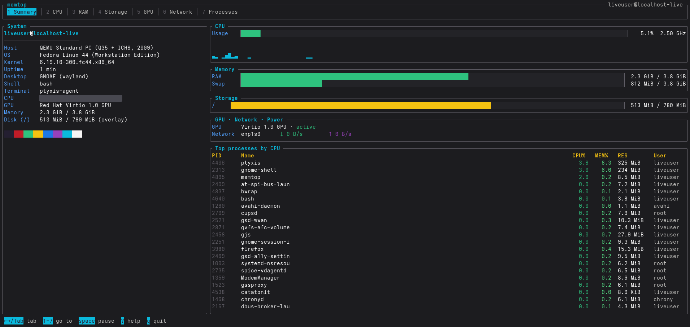

# memtop

System information and resource monitor in a single terminal screen, for Linux.



memtop brings together two things that are usually separate tools: a summary of the machine
(model, operating system, CPU, GPU, memory…) and a live monitor of CPU, memory, disks, GPU,
network and processes. It is written in Rust with [ratatui](https://ratatui.rs) and ships as
a single static binary with no system dependencies.

The interface and messages are available in English and Spanish (see [`--lang`](#usage)).

## Contents

- [Screen](#screen)
- [Installation](#installation)
- [Usage](#usage)
- [Configuration](#configuration)
- [Compatibility policy](#compatibility-policy)
- [Keys](#keys)
- [Data and permissions](#data-and-permissions)
- [Troubleshooting](#troubleshooting)
- [Development](#development)
- [Contributing](#contributing)
- [License](#license)

## Screen

```
┌──────────────────────────────────────────────────────────────────────┐
│ Tabs: 1 Summary · 2 CPU · 3 RAM · 4 Storage · 5 GPU · 6 Network · …  │
├──────────────────────┬───────────────────────────────────────────────┤
│   System             │                                               │
│   user@host,         │   Content of the active tab                   │
│   OS, kernel, CPU,   │   (bars, history charts, tables)              │
│   GPU, memory…       │                                               │
│                      │                                               │
│                      │                                               │
├──────────────────────┴───────────────────────────────────────────────┤
│ Keyboard shortcuts for the current tab                               │
└──────────────────────────────────────────────────────────────────────┘
```

With `logo = true` in the [configuration](#configuration), the memtop logo is shown above
the System panel.

| # | Tab | Content |
|---|---|---|
| 1 | Summary | CPU usage with history, RAM and swap, partitions, GPU status, network, battery and top processes by CPU |
| 2 | CPU | Model, cores and threads, frequencies, load average, per-thread usage, 120 s history and temperature sensors |
| 3 | RAM | Used, cache and swap; `/proc/meminfo` details; history and top processes by memory |
| 4 | Storage | Physical disks (model, type, size, temperature, read and write speed) and mounted partitions |
| 5 | GPU | For each GPU: vendor, driver, PCI address, power state, usage, VRAM, clock, temperature and power draw |
| 6 | Network | Download and upload history, and interfaces with IP, MAC, current speed and totals |
| 7 | Processes | htop-style list with search, column sorting, an own-processes filter and signal sending |

Data refreshes every second (configurable with `--interval` or in the
[configuration file](#configuration)).

## Installation

### Prebuilt binary (recommended)

Every [release](https://github.com/SalomonAvila/memtop/releases) includes **static** binaries
for `x86_64` and `aarch64`. They work on any Linux distribution (Ubuntu, Debian, Fedora,
Arch, Alpine…) and any `glibc` version, because they do not depend on system libraries.

```sh
arch="$(uname -m)"   # x86_64 or aarch64
curl -LO "https://github.com/SalomonAvila/memtop/releases/latest/download/memtop-${arch}-unknown-linux-musl.tar.gz"
tar xzf "memtop-${arch}-unknown-linux-musl.tar.gz"
install -Dm755 "memtop-${arch}-unknown-linux-musl/memtop" ~/.local/bin/memtop
```

Make sure `~/.local/bin` is in your `PATH`. Each published archive comes with a `.sha256`
file to verify the download:

```sh
sha256sum -c "memtop-${arch}-unknown-linux-musl.tar.gz.sha256"
```

### Fedora (COPR)

memtop is packaged for Fedora 43, 44, 45 and Rawhide (`x86_64` and `aarch64`) in
[COPR](https://copr.fedorainfracloud.org/coprs/mrmich/memtop/):

```sh
sudo dnf copr enable mrmich/memtop
sudo dnf install memtop
```

Updates arrive with the rest of the system through `sudo dnf upgrade`.

### From source

Requires Rust **1.95 or newer**, installed with [rustup](https://rustup.rs) (the Rust
packages shipped by many distributions are older), and a C linker:

| Distribution | Linker |
|---|---|
| Ubuntu / Debian | `sudo apt install build-essential` |
| Fedora | `sudo dnf install gcc` |
| Arch | `sudo pacman -S base-devel` |

```sh
git clone https://github.com/SalomonAvila/memtop.git
cd memtop
cargo install --path . --locked
```

The binary is installed to `~/.cargo/bin/memtop`. Every dependency is a Rust crate that
Cargo downloads and builds; no system development libraries are needed.

To build the same static binary that is published:

```sh
rustup target add x86_64-unknown-linux-musl
cargo build --release --locked --target x86_64-unknown-linux-musl
# output: target/x86_64-unknown-linux-musl/release/memtop
```

### Optional program

memtop works without it; it only adds to what is shown.

| Program | What it adds | Where it comes from |
|---|---|---|
| `nvidia-smi` | Usage, VRAM, temperature, power draw and clock of NVIDIA GPUs | Installed with the proprietary NVIDIA driver |

## Usage

```sh
memtop                                  # opens on the Summary tab
memtop --interval 2 --lang es           # refresh every 2 s, Spanish interface
```

| Option | Description |
|---|---|
| `-i`, `--interval SECS` | Seconds between refreshes. Default `1`, minimum `0.2` |
| `--lang LANG` | Interface language: `auto` (from `LANG`), `en` or `es` |
| `-c`, `--config PATH` | Use this configuration file instead of the default one |
| `--print-config` | Print a commented example configuration and exit |
| `-V`, `--version` | Show the version |
| `-h`, `--help` | Show the help |

Exit codes: `0` success, `1` runtime error, `2` invalid option or configuration file error.

## Configuration

memtop reads `$XDG_CONFIG_HOME/memtop/config.toml` (usually `~/.config/memtop/config.toml`)
if it exists; otherwise it uses the defaults. To create it with every option commented:

```sh
mkdir -p ~/.config/memtop
memtop --print-config > ~/.config/memtop/config.toml
```

The full template is [`config.example.toml`](config.example.toml). Every key is optional:

| Key | Values | Default |
|---|---|---|
| `language` | `"auto"` (from `LANGUAGE`, `LC_ALL`, `LC_MESSAGES` or `LANG`), `"en"`, `"es"` | `"auto"` |
| `interval` | Seconds between refreshes, `0.2` or more | `1.0` |
| `start_tab` | `"summary"`, `"cpu"`, `"ram"`, `"storage"`, `"gpu"`, `"network"`, `"processes"` | `"summary"` |
| `logo` | `true` shows the memtop logo above the System panel; `false` lets the System panel take the whole column | `false` |
| `[processes] sort` | `"cpu"`, `"memory"`, `"pid"`, `"name"`, `"user"` | `"cpu"` |
| `[processes] mine_only` | `true` / `false` | `false` |
| `[colors] accent` | Color of titles, the active tab and keys | `"cyan"` |
| `[colors] muted` | Color of borders and secondary text | `"darkgray"` |
| `[colors] label` | Color of field names | `"lightblue"` |
| `[colors] selection` | Background of the selected row in Processes | `"#233755"` |

Colors accept names (`red`, `lightcyan`, `darkgray`…), hexadecimal (`"#rrggbb"`) or an index
into the 256-color palette (`"0"` to `"255"`).

For example, to always open on Processes, sorted by memory, with a green accent:

```toml
start_tab = "processes"

[processes]
sort = "memory"

[colors]
accent = "green"
```

**Precedence:** defaults < file < command-line options. For example, `memtop -i 2` uses a
2 s interval even if the file says otherwise, but keeps the rest of the file.

**Errors:** if the file has a syntax error, an unknown key (for example a typo such as
`intervals`) or an invalid value, memtop does not start and shows the exact line:

```
memtop: error in ~/.config/memtop/config.toml: TOML parse error at line 1, column 1
  |
1 | intervals = 2
  | ^^^^^^^^^
unknown field `intervals`, expected one of `language`, `interval`, `start_tab`, `logo`, `processes`, `colors`
```

Upgrading from 0.1.x? The flags and configuration keys were renamed; see the
[changelog](CHANGELOG.md).

## Compatibility policy

Starting with version 1.0, semantic versioning guarantees compatibility for command-line
flags, configuration keys and values, and exit codes within a major version. Changes that
break compatibility in these areas require a new major version.

Semantic versioning does not guarantee stability of the screen layout, colors, interface
text and translations, or the order of rows.

## Keys

Press `?` inside memtop to see this list.

| Key | Action |
|---|---|
| `←` `→`, `Tab`, `Shift+Tab`, `h` `l` | Previous / next tab |
| `1` … `7` | Go to a tab |
| `Space` | Pause or resume refreshing |
| `?` | Help |
| `q`, `Esc`, `Ctrl+C` | Quit |

In the **Processes** tab:

| Key | Action |
|---|---|
| `↑` `↓`, `j` `k` | Move the selection |
| `PgUp` `PgDn` | Move 15 rows at a time |
| `g` / `G`, `Home` / `End` | Go to the first / last row |
| `/` | Search by name, command line, PID or user (`Enter` accepts, `Esc` clears) |
| `c` `m` `p` `n` `u` | Sort by CPU, memory, PID, name or user. Pressing the key again reverses the order |
| `o` | Show only the current user's processes |
| `x` | Clear search and filters |
| `t`, `F9` | Send SIGTERM to the selected process (asks for confirmation) |
| `K` | Send SIGKILL to the selected process (asks for confirmation) |

When searching, filtering or sorting, the selection goes back to the first process in the
list so a hidden process is never left selected.

## Data and permissions

memtop only **reads** local information: it needs no root, writes no files and does not use
the network. The only action that changes the system is sending a signal to a process, and
it always asks for confirmation; as a regular user it only affects your own processes.

| Data | Source |
|---|---|
| CPU, processes, network, partitions, temperatures | [`sysinfo`](https://crates.io/crates/sysinfo) crate (`/proc`, `/sys`) |
| Memory | `/proc/meminfo` |
| Physical disks, NVMe speed and temperature | `/sys/block` |
| Machine model | `/sys/class/dmi/id` |
| Operating system | `/etc/os-release` |
| Battery | `/sys/class/power_supply` |
| GPU (name, driver, power state, AMD and Intel data) | `/sys/bus/pci/devices` and the PCI database bundled in `data/pci-gpu.ids` |
| NVIDIA GPU (usage, VRAM, temperature, power draw) | `nvidia-smi`, if installed |

**Laptops with hybrid graphics.** Querying `nvidia-smi` wakes up the discrete GPU and
increases power usage. memtop only queries it while the GPU tab is visible and never while
the GPU is suspended; on every other tab it only reads the power state from `/sys`.

**Containers.** Inside a container, the data in `/proc` and `/sys` may belong to the host
(kernel, disks, sensors) or be restricted (network, processes).

## Troubleshooting

**memtop disappeared from `dnf` after upgrading Fedora.** Each Fedora release is built
separately in COPR, and a new release may take a few days to be added. Run
`sudo dnf upgrade --refresh`; if the package is still missing, please
[open an issue](https://github.com/SalomonAvila/memtop/issues/new/choose). The
[prebuilt binary](#prebuilt-binary-recommended) works meanwhile.

**memtop does not start after upgrading from 0.1.x.** The command-line flags and
configuration keys were renamed to English in 0.2.0, and memtop shows the line it does not
understand. Regenerate the file with `memtop --print-config > ~/.config/memtop/config.toml`
or rename the keys as listed in the [changelog](CHANGELOG.md).

**"must be run in an interactive terminal".** memtop draws a full-screen interface, so its
output cannot be piped or redirected. Run it directly in a terminal.

**No temperatures in the CPU tab.** Temperatures come from the kernel's hardware sensors
(`/sys/class/hwmon`). If that directory is empty, the sensor driver for your hardware is not
loaded (common in virtual machines and on some desktops); `sensors-detect` from the
`lm_sensors` package can find and load it.

**The NVIDIA GPU shows no usage or VRAM.** These come from `nvidia-smi`, which is only
available with the proprietary NVIDIA driver (not with `nouveau`). memtop only queries it
while the GPU tab is open, so the first values take a couple of seconds ("Querying
nvidia-smi…"). If the GPU is "Suspended (saving power)", memtop does not query it on purpose,
to avoid waking it up and draining the battery.

**Colors look wrong or the logo is garbled.** memtop uses 24-bit colors for some elements.
Use a terminal with true color support (most modern ones), or pick colors from the 256-color
palette in the `[colors]` section of the configuration.

## Development

```sh
cargo run --release          # run
cargo test                   # tests
cargo fmt                    # format
cargo clippy --all-targets -- -D warnings
```

### Layout

```
memtop/
├── .copr/Makefile              Builds the SRPM for COPR
├── .github/
│   ├── CODEOWNERS              Every change needs the maintainer's review
│   ├── ISSUE_TEMPLATE/         Bug report and feature request forms
│   ├── pull_request_template.md
│   └── workflows/
│       ├── ci.yml              Format, clippy, tests, static binaries and RPMs on every push
│       └── release.yml         Publishes binaries when a vX.Y.Z tag is pushed
├── data/
│   └── pci-gpu.ids             Extract of pci.ids with the GPU vendors
├── docs/
│   ├── RELEASING.md            Maintainer notes: releases, COPR and branch protection
│   └── ROADMAP.md              What is planned until 1.0
├── packaging/
│   └── memtop.spec             RPM package for Fedora
├── scripts/
│   └── update-pci-ids.sh       Regenerates data/pci-gpu.ids
├── src/
│   ├── main.rs                 Command-line options and main loop
│   ├── config.rs               Configuration file
│   ├── i18n.rs                 Interface language and translated text
│   ├── app.rs                  Interface state and keys
│   ├── ui.rs                   Drawing of every tab
│   ├── system.rs               Reading CPU, memory, disks, network, processes, sensors and battery
│   ├── gpu.rs                  GPU detection and nvidia-smi queries
│   ├── pci.rs                  GPU names from the bundled PCI database
│   └── logo.rs                 memtop logo in pixel art
├── CHANGELOG.md                Changes in each version
├── CODE_OF_CONDUCT.md
├── CONTRIBUTING.md             How to contribute
├── config.example.toml         Configuration template (also via memtop --print-config)
├── Cargo.toml
├── Cargo.lock
├── LICENSE
├── SECURITY.md                 How to report vulnerabilities
└── THIRD_PARTY_NOTICES.md      Licenses of third-party data and crates
```

### Updating the GPU database

`data/pci-gpu.ids` is embedded in the binary at build time. To pick up new models:

```sh
scripts/update-pci-ids.sh                            # downloads the latest pci-ids.ucw.cz
scripts/update-pci-ids.sh /usr/share/hwdata/pci.ids  # or uses a local copy
```

### Releasing a version

The release process, the COPR setup and the branch protection rules are described in
[docs/RELEASING.md](docs/RELEASING.md).

## Contributing

Contributions are welcome. Read [CONTRIBUTING.md](CONTRIBUTING.md) before opening a pull
request (against `develop`), and report security problems privately as described in
[SECURITY.md](SECURITY.md). Everyone taking part is expected to follow the
[Code of Conduct](CODE_OF_CONDUCT.md).

What is planned until 1.0 is in [docs/ROADMAP.md](docs/ROADMAP.md).

## License

Code licensed under [MIT](LICENSE).

`data/pci-gpu.ids` is an extract of the [pci.ids](https://pci-ids.ucw.cz) database,
distributed under GPL-2.0-or-later or BSD-3-Clause at your choice; memtop uses it under
BSD-3-Clause. The full text is in [THIRD_PARTY_NOTICES.md](THIRD_PARTY_NOTICES.md), which is
included in every release.
